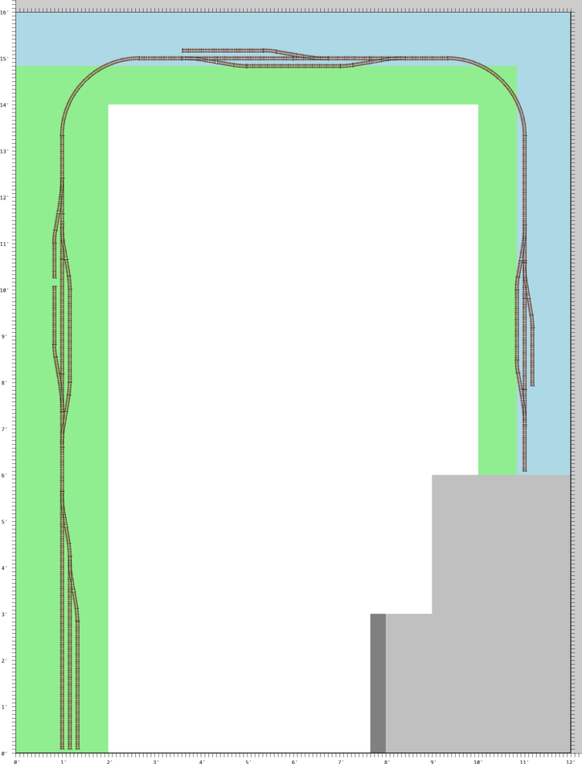
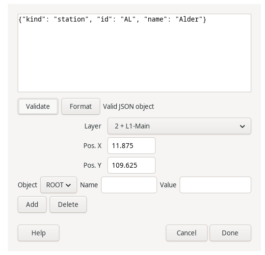
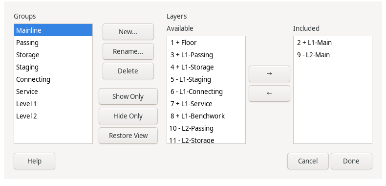
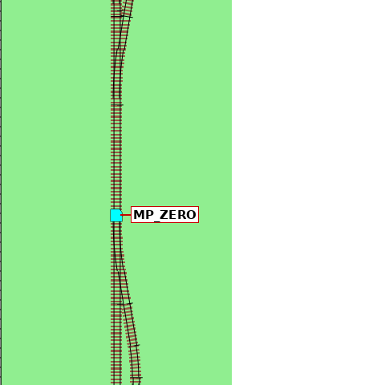
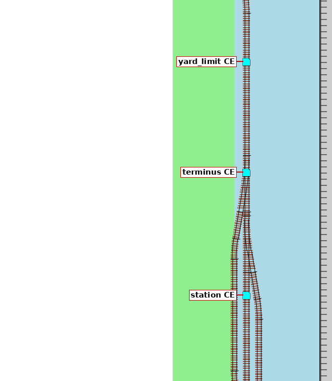
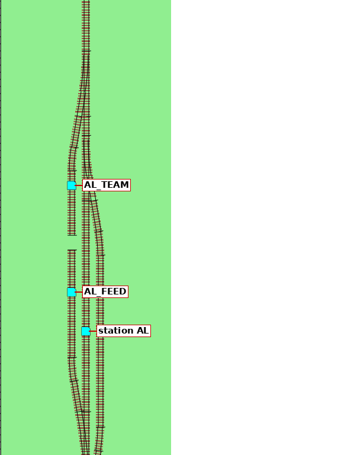
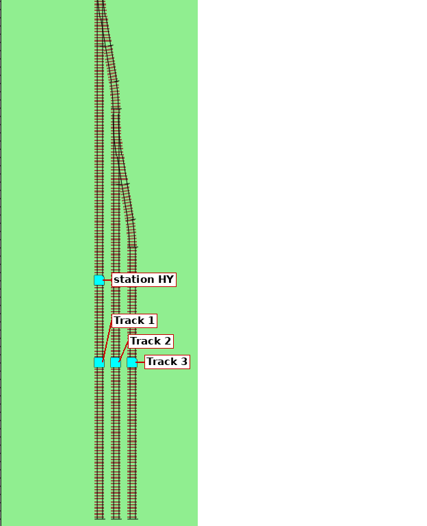
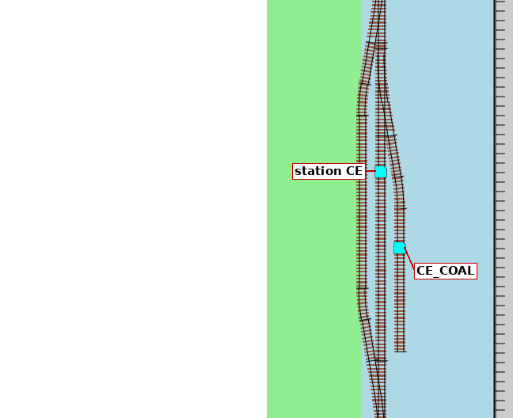

# Operating your layout: a tutorial

Part 2 of the Hillside tutorial. [Part 1, the layout config guide](layout-config-guide.md),
built the Hillside Division: a 12×16 ft room, shelves around three walls, and a track plan
laid by `generate_track_plan`. This part makes that layout **operable**: it records the
railroad as built (where the stations are, which tracks are industries and yards, how far it is
from one place to the next) so a check can find mistakes and an operations program can use it.

The rules are the [Operating Data Conventions](operating-conventions.md); section numbers in
brackets, like [4.3], point into them. Every example below was run through the tools, and the
results are quoted as the tools give them; the test suite rebuilds each chapter's layout and
checks those results (`mcp/tests/test_tutorial.py`), so this page can't drift from the tools.

**Who this is for:** you've drawn a layout in XTrkCAD and know layers and notes. You don't need
to know JSON Notes, Layer Groups or the MCP tools yet.

**How to read the examples.** Each step shows what you'd ask your assistant (Claude, with the
XTrkCAD MCP server connected), the tool call that answers it, and what comes back:

> *Check my layout's operating data.*

```
check_conventions("hillside_division.xtc")
```

You can also call the tools yourself; the prompt is just the plain-language version.

---

## 1. What this is for

A layout drawing says where the track goes. Operating it needs more: that this siding belongs to
Alder, that the spur behind it is a feed mill taking two cars, that Cedar is the end of the line
21.5 miles out. The conventions record those facts **in the layout file itself**, so they move
with the drawing and are never typed twice.

They record the railroad **as built**. Trains, schedules, waybills and crews are the operations
system's job; it reads the layout's data and refers to places by their `id` [1].

The flow:

1. Draw the layout in XTrkCAD (Part 1 did that for Hillside).
2. Add the operating data: JSON Notes on the track, Layer Groups for the layers.
3. `check_conventions` finds what's missing or wrong.
4. `export_layout_data` writes `layout_data.json` for an operations program
   ([schema](layout_data_v2.md)).

Three rules of thumb run through all of it:

- **A fact sits where it is on the layout.** A station's note goes on the station's main track;
  an industry's on its spur. The note's position is part of its data.
- **A set of layers with one meaning is a Layer Group.** "These layers are the main line" is a
  group named `Mainline`.
- **Nothing is typed twice.** Lengths, car capacities and mileposts are computed from the track;
  notes never hold them.

## 2. Before you start

**The layout.** Start from Part 1's result: the Hillside layout with its track.

> *Generate the Hillside layout and lay its track plan.*

```
generate_layout("hillside_division.yaml", "hillside_division.xtc")
generate_track_plan("hillside_division.yaml", "hillside_division.xtc")
```



**Layer names.** Hillside's layers are named `L1-Main`, `L1-Passing`, `L1-Storage` and so on:
the `L1-` prefix is the level (deck), the rest says what kind of track the layer holds [3.3].

**JSON Notes.** A JSON Note is an XTrkCAD note whose text is one JSON object, like
`{"kind": "station", "id": "AL"}`. Place one with **Draw > Notes > JSON Note**: click where it goes, then
type the object into the box at the top of the dialog (it starts with a template) and press
**Validate**. Every note the conventions read has a `kind` (what it is) and an `id` (its short name);
the other fields depend on the kind [4.0].



**Position is data.** A note belongs to the nearest track **on its own layer**: put a station's
note on an `L1-Main` layer, on the main. A note that lands beside its track is reported:

```
warning NOTE_FAR_FROM_TRACK
  station BI: 5.0 in from the nearest track (44)
  hint: It is on track 43 of layer L1-Passing: move the note to that layer.
```

That note was put at y=175 instead of on the main at y=180, near Birch's siding.

**Reading the check.** `check_conventions` lists every rule the layout breaks, errors first.
Each finding has a severity, a rule id (stable: match it, not the wording), a message, often a
hint, and the note, layer and track it's about [1, 9]:

- **error**: something the export can't work around; it refuses until it's fixed (or forced);
- **warning**: reported, results still produced;
- **info**: a default was used, or something is worth a look.

## 3. Categories: telling the main from the rest

Every track layer has a **category**: main line, passing track, storage, staging, connecting
track, service, scenery or ignored. A category is a Layer Group with one of those reserved names:
`Mainline`, `Passing`, `Staging`, `Storage`, `Service`, `Connecting`, `Scenery`, `Ignore` [3.1].

Hillside already has them: `generate_layout` makes one per track type, holding that type's
layer on each level (**Manage > Layer Groups…** shows them):

| Group | Layers |
|---|---|
| `Mainline` | L1-Main, L2-Main |
| `Passing` | L1-Passing, L2-Passing |
| `Storage` | L1-Storage, L2-Storage |
| `Staging` | L1-Staging, L2-Staging |
| `Connecting` | L1-Connecting, L2-Connecting |
| `Service` | L1-Service, L2-Service |



(The `Level 1` and `Level 2` groups are for showing and printing one deck; they aren't
categories.)

Main track is what everything else is measured along, so the category matters. Two mistakes
the check catches:

- **A layer in two category groups** is an error: a layer has one category.

  ```
  error CATEGORY_LAYER_IN_TWO
    Layer L1-Main is in category groups Mainline and Passing
    hint: A layer has one category; take it out of all but one group.
  ```

- **A track layer in no category group** is a warning. Its category then comes from its name
  (`L1-Main` is main line), but say it with a group.

  ```
  warning CATEGORY_LAYER_NONE
    Track layer L1-Main is in no category group; mainline from its name
    hint: Add it to one of: Mainline, Passing, Staging, Storage, Service, Connecting, Scenery, Ignore
  ```

Run the check on Hillside now and it finds one thing, the subject of the next chapter:

> *Check my layout's operating data.*

```
error MP_NO_ANCHOR
  The layout has main track but no MP anchor
  hint: Add a reference note with "mp" (0 at MP zero) on its main track.
```

## 4. Mileposts

A **milepost** (MP) is a position along the main line. Timetables, train orders and the
operations program all locate places by MP, so the layout needs MPs. You don't type them in:
you fix MP zero, say how much layout length is one mile, and the tools count the rest along the
main [5.1].

**MP zero** is a `reference` note with `"mp": 0`, placed on the main track at that point. It
also carries the **MP scale**: how much layout one MP is [4.2]. Hillside puts MP zero at the yard
throat, the first switch the main meets, and counts one MP per foot:

```json
{"kind": "reference", "id": "MP_ZERO", "mp": 0, "mp_scale": 12, "mp_unit": "in"}
```

Place it on `L1-Main` at the yard throat switch, at its points (x 12, y 67.7).



- `mp_scale` and `mp_unit` (`in`, `ft`, `cm` or `m`) say how long one MP is: 12 in here. Pick
  whatever makes your timetable read well; a big layout might use 24 in.
- A note with an `mp` is an **anchor**: the track at the note *is* that milepost. MPs then grow
  along the main away from zero.
- A second anchor further along resets the count, if you want a place to have an exact MP: the
  count carries on from the anchor's value.
- A railroad that has no zero on the layout (a line passing through, from staging to staging)
  uses a start anchor and an end anchor instead [5.1].

Check again, and the layout is clean: 0 errors, 0 warnings, 0 info. The MPs are there, but
nothing is placed along the main yet; that's the stations' job.

## 5. Stations

A **station** is a named place on the main: a timetable stop. Its note goes on the main track at
the station [4.3]. Where the MP of a station comes from depends on its track [5.2]:

- **A station with a passing siding** has the siding's two switches as its limits, and its MP is
  the midpoint of the main between them.
- **A terminus**, the end of the line, has no exit: its MP is the switch where the terminus starts.
- **A station without a siding** takes the MP at its note.

Hillside has four. Alder and Birch are pass-through stations with sidings:

```json
{"kind": "station", "id": "AL", "name": "Alder"}
{"kind": "station", "id": "BI", "name": "Birch"}
```

Place Alder's on `L1-Main` between its two switches (x 12, y 109.5), and Birch's on the north
wall's main (x 72, y 180).

**Hillside, the yard**, is the line's home terminal at MP zero. Its note sits on a yard track,
off the main, so it says where it joins the main with `ref_tag`: the named point MP_ZERO.
`terminus` says no train runs beyond it.

```json
{"kind": "station", "id": "HY", "name": "Hillside", "terminus": true, "ref_tag": "MP_ZERO"}
```

Place it on `L1-Storage`, on yard track 1 (x 12, y 30).

**Cedar** is the other end of the line. A terminus needs to know where it starts: a `terminus`
note on the main-track switch where the terminus begins [4.10]. For Cedar that's the first
switch of its runaround:

```json
{"kind": "station", "id": "CE", "name": "Cedar", "terminus": true}
{"kind": "terminus", "id": "CE"}
```

Place the station note on the main between Cedar's switches (x 132, y 114) and the terminus note
on the runaround's north switch (x 132, y 134). Leave the terminus note out and the check asks:

```
warning TERMINUS_NO_START
  Terminus station CE: where does the terminus start?
  hint: Add a terminus note on the main-track switch where it starts (or ref_tag the MP zero
  anchor, if the terminus starts there).
```

Hillside's terminus needs no such note: it starts at MP zero, which its `ref_tag` names.

A station note must sit on main track. One placed on the passing siding instead is reported
twice: it isn't on the main, and the MP count can't reach it along the main:

```
warning MP_UNREACHABLE
  Station AL2 can't be reached along the main from MP_ZERO
warning STATION_NOT_ON_MAIN
  Station AL2 is not on main track
  hint: Place a station note on the main at the station.
```

With the four notes in place the check is clean again, and the export now has the stations,
their MPs and their sidings:

> *Export my layout's operating data.*

```
export_layout_data("hillside_division.xtc")
```

| Station | MP | Limits (MP) | Siding | Main between the switches |
|---|---|---|---|---|
| HY Hillside | 0.0 | terminus | | |
| AL Alder | 3.375 | 0.963 – 5.786 | 5 cars | 4 cars |
| BI Birch | 13.643 | 11.232 – 16.054 | 5 cars | 3 cars |
| CE Cedar | 21.521 | terminus | 4 cars | 3 cars |

The track plan asked for 5-car sidings at Alder and Birch, and the export gives 5: both count
what a track holds between its **clearance points**, where a car stops fouling the other leg of
the switch [2]. The main between the switches holds fewer: an industry's spur leaves it there
(Alder's feed mill, Birch's lumber spur, chapter 7), and that switch, with the length a car
needs to clear it, doesn't count.

## 6. Yard limits

**Yard limits** are a stretch of main where trains may move without a clearance, at restricted
speed, so a switcher can work the station. A layout needs no yard-limit notes: every station's
zone defaults to its own limits, from entry switch to exit switch [4.4]. At Alder that's MP
0.963 – 5.786, the siding's switches.

A **YL board** is a `yard_limit` note with the station's id, on the main where the board stands.
It moves that end of the zone out to the board. Cedar is a terminus, so its default zone is only
the terminus switch (MP 21.521); a board out on the line gives its switcher room to run around
the train:

```json
{"kind": "yard_limit", "id": "CE"}
```

Place it on `L1-Main` on the way into Cedar, between the curve and the runaround's north switch
(x 132, y 152).
The export's `yard_limits` then has Cedar's zone from the board to the end of the line:

| Zone | From MP | To MP | Source |
|---|---|---|---|
| CE | 20.261 | 21.521 | board |

The other stations keep their default zones (`source: station`).



- One board is enough only at a terminus, where trains come from one side. Anywhere else trains
  come from both ends, so a zone has a board at each end, or none. A single board for Alder,
  beyond its north switch:

  ```
  warning YARD_LIMIT_ONE_BOARD
    Yard limit AL has one board, and isn't a terminus
    hint: Add the second board, at the other end of the zone; one board is enough only for a
    terminus station.
  ```
- A board whose id is no station makes a zone of its own, for yard limits away from a station.
- Boards stand on the main. One put on the passing siding instead is an error:

  ```
  error YARD_LIMIT_NOT_ON_MAIN
    Yard-limit board AL is not on main track
  ```

## 7. Industries and team tracks

An **industry** is a shipper with its own spur. Its note goes on the spur and says which station
switches it, how many cars it takes and what it ships and receives [4.5]:

```json
{"kind": "industry", "id": "AL_FEED", "name": "Alder Feed Mill", "station": "AL",
 "car_spots": 2, "car_types": ["XM", "LO"], "loads_in": ["grain"], "loads_out": ["feed"]}
{"kind": "industry", "id": "BI_LUMBER", "name": "Birch Lumber", "station": "BI",
 "car_spots": 3, "car_types": ["FM"], "loads_in": ["lumber"]}
```

Place the feed mill's on `L1-Storage` on the spur west of Alder's main (x 10, y 115), and the
lumber yard's on the spur north of Birch's main (x 52, y 182).

- `station`: where the switcher comes from. Leave it out for an industry out on the line with no
  station of its own.
- `car_spots`: how many cars the industry takes, an operating choice. The track's capacity is
  computed, and exported beside it.
- `car_types`: AAR mechanical designations: `XM` boxcar, `LO` covered hopper, `FM` flatcar,
  `HM` hopper, `TM` tank car [7].
- `loads_in`, `loads_out`: what arrives and what leaves, in plain words.

A **team track** is a public siding: anyone without a spur of their own loads and unloads cars
there [4.5a]. It takes the same fields, but car types and loads are usually left out, since it
takes anything. Alder has one, on the short spur beyond the station's north switch:

```json
{"kind": "team_track", "id": "AL_TEAM", "name": "Alder team track", "station": "AL",
 "car_spots": 2}
```

Place it on `L1-Storage` (x 10, y 130). A team track without `station` stands alone, away from
any station, and is a timetable stop itself. One track that is both a team track and a house
track (chapter 9) carries both notes.



The export lists each with its spots and what its track holds:

| Industry | Station | Branch MP | Car spots | Track holds |
|---|---|---|---|---|
| AL_FEED Alder Feed Mill | AL | 1.781 | 2 | 3 cars |
| AL_TEAM Alder team track | AL | 6.776 | 2 | 2 cars |
| BI_LUMBER Birch Lumber | BI | 14.398 | 3 | 4 cars |

The branch MP is where the spur leaves the main. The track is measured between clearance points
like a siding [2], so the feed mill's spur holds 3 cars although only 2 are spotted.

What the check says about industries:

- `car_spots` left out takes 2, with a notice:

  ```
  info CAR_SPOTS_DEFAULT
    industry BI_X: car_spots not given, 2 used
  ```

- A car type that isn't a known code is probably a typo:

  ```
  warning UNKNOWN_CAR_TYPE
    industry BI_X: unknown car type(s) BOXCAR
    hint: Use AAR mechanical designations (XM, HM, TM, ...).
  ```

- More spots than the track holds:

  ```
  warning CAR_SPOTS_EXCEED_TRACK
    team_track AL_T2: 4 car spots, its track holds 2
    hint: Give "car_spots": 2 or less, or lengthen the track.
  ```

- An industry on the main or a passing track is allowed (it is usually a timetable stop of its
  own), with an `INDUSTRY_ON_MAIN` notice.

## 8. Yards and staging

A yard is a set of tracks with jobs. Each track gets a `yard_track` note: the yard's location id,
a `label` unique within the yard, and its `function` [4.7]. Hillside's yard has three:

```json
{"kind": "yard_track", "id": "HY", "label": "Track 1", "function": "arrival_departure"}
{"kind": "yard_track", "id": "HY", "label": "Track 2", "function": "classification"}
{"kind": "yard_track", "id": "HY", "label": "Track 3", "function": "classification"}
```

Place them on `L1-Storage`, one on each yard track toward its south end (x 12, 14 and 16,
y 20). Track 1, straight off the main, is where trains arrive and leave; the other two are for
sorting cars.



The export's `yards` gives each track's capacity:

| Track | Function | Holds |
|---|---|---|
| Track 1 | arrival_departure | 8 cars |
| Track 2 | classification | 5 cars |
| Track 3 | classification | 6 cars |

Tracks 2 and 3 are within a fraction of an inch of each other, about 36 in between clearance
points, but Track 2 falls just short of six cars, and capacity counts whole cars.

- **Functions** for a station's yard: `arrival`, `departure`, `arrival_departure`,
  `classification`, `runaround`, `lead`, `interchange`, `caboose`, `rip` (repair in place),
  `storage`, `engine`. An industry's own tracks (a mine, a mill) use `loading`, `empties`,
  `loads`, `service` and `lead`, with the industry's id.
- **Staging** is the rest of the world, off the visible layout. A `staging` note on its lead
  names it; its tracks are `yard_track` notes with function `staging`, or any yard function,
  as staging can set tracks aside too [4.6]. Hillside has no staging.
- **Interchange** with another railroad is a track function: `interchange`, with `railroads`
  naming both. Chapter 11 has more than one railroad.

The check's yard rules:

```
error YARD_TRACK_DUPLICATE_LABEL
  Two tracks labelled 'Track 2' in 'HY'
error YARD_TRACK_BAD_FUNCTION
  Yard track HY Track 3: function 'sorting' is not one for a station
  hint: Functions: arrival, arrival_departure, caboose, classification, departure, engine, interchange, lead, rip, runaround, storage
info YARD_TRACK_NO_FUNCTION
  Yard track HY Track 3 has no function
```

## 9. House tracks, storage and facilities

Three more kinds record the railroad's own tracks [4.8]:

- **`house_track`**: the track at the freight house, where the railroad's staff handle small
  shipments (less than carload). Its `id` is the station's (or an industry's); a location with
  several gives each a `label`.
- **`storage`**: a stand-alone spur for parking cars.
- **`facility`**: a servicing point, the railroad's own industry: coal, water, sand, fuel, ice,
  ash, a turntable, engine service, a scale, a repair track.

Cedar has a coal trestle on the spur east of its main, where engines take coal and hoppers of it
are spotted:

```json
{"kind": "facility", "id": "CE_COAL", "name": "Cedar coal trestle", "type": "coal",
 "location": "CE", "car_spots": 3}
```

Place it on `L1-Service` (x 134, y 106). Its track holds 3 cars, and the export has
`capacity_cars: 3`, `car_spots: 3`.



`car_spots` on a facility or storage track has **no default**. Only spots a note gives count as
car storage in Op Density (9.1 in the spec): a turntable or water tank holds no cars, and isn't
counted. The check holds the spots to the track as for an industry, and knows the facility
types:

```
warning CAR_SPOTS_EXCEED_TRACK
  facility CE_COAL: 5 car spots, its track holds 3
  hint: Give "car_spots": 3 or less, or lengthen the track.
error FACILITY_BAD_TYPE
  Facility CE_X: type 'coaling' is not a facility type
  hint: Types: ice, engine_service, turntable, fuel, water, sand, coal, ash, scale, car_repair
```

## 10. Switchbacks

A **switchback** is where a train has to reverse to go on: it pulls past a switch onto a tail
track, then backs out the other way. It's a track configuration, so it gets its own note, on the
tail track [4.9]:

```json
{"kind": "switchback", "id": "BB_SWB", "serves": "BB"}
{"kind": "switchback", "id": "MC_SWB", "serves": "MC", "switches": [412, 418]}
```

Hillside has none; these are from the New York & Eastern layout.

- `serves`: the station or industry the switchback reaches.
- `switches`: the main-track switch where trains reverse. Left out, it's the switch the tail
  track leaves. NYE's MC lists two, which together act as the switchback switch: its passing
  track rejoins the main beyond the first one.
- The tail is never main track: it may end in a bumper, or go on to an industry, a yard or
  another subdivision, but its layer isn't in `Mainline`. A switchback note on the main is an
  error:

  ```
  error SWITCHBACK_TAIL_ON_MAIN
    Switchback CE_SWB: its tail track (72) is on a Mainline layer
    hint: The tail track is never main track; put it on its own layer.
  ```

The export lists each switchback with the switches and the tail's length, and marks the
stations and industries it serves with `switchback: true`.

## 11. More than one railroad

Everything so far belongs to the layout's one railroad, which has no name yet: the export's
`railroads` list is empty and every station's `railroad` is `null`. A `railroad` note names it
[4.1]; its position isn't used:

```json
{"kind": "railroad", "id": "HD", "name": "Hillside Division", "reporting_marks": "HD"}
```

Place it on `L1-Main` near MP zero (x 12, y 74). The export then has the railroad, its MP scale
and its anchor, and each station and yard-limit zone has `"railroad": "HD"`.

A layout with **more than one railroad**, or one railroad with several MP lines, needs more:

- Each railroad and **subdivision** (one MP line) gets a note, and a Layer Group holding its
  layers, named by the note's `group` [3.2]. A layer belongs to the railroad whose group holds
  it, so each subdivision counts its own mileposts from its own anchors.
- A subdivision with no MP zero on the layout, running from staging to staging, uses a start
  and an end anchor [5.1].
- All location ids share one namespace, across railroads: a station, an industry, a team track
  and a staging yard can't have the same id.

  ```
  error ID_DUPLICATE_LOCATION
    Location id 'AL' is used by a station and an industry
    hint: Stations, industries, team tracks and staging yards share one id namespace.
  ```

- A **joint station**, where two railroads meet, is the exception: one id, with a `station` note
  on each railroad's main. NYE's Williamsport (WP) is the C&O main upstairs and the NYE branch
  downstairs; each note has its own MP, and the export lists WP once per subdivision [4.3].
  Interchange tracks between them are `yard_track` notes with `function: "interchange"` and both
  `railroads`.

A `group` that names no Layer Group is an error:

```
error GROUP_UNKNOWN
  railroad HD: Layer Group 'HD' doesn't exist
  hint: Groups: Mainline, Passing, Storage, Staging, Connecting, Service, Level 1, Level 2
```

## 12. Exporting

With the railroad named, Hillside's operating data is complete and the check is clean:

> *Check my layout's operating data, then export it.*

```
check_conventions("hillside_division.xtc")
export_layout_data("hillside_division.xtc")
```

The export writes `layout_data.json` beside the layout ([schema](layout_data_v2.md)): the
railroad, stations, yard limits, industries and team tracks, yards, storage, switchbacks,
facilities, the distances between stations, and the check's findings in `issues` [8]. The
segments, in prototype feet along the main:

| From | To | Length |
|---|---|---|
| HY | AL | 293.932 ft |
| AL | BI | 894.367 ft |
| BI | CE | 686.211 ft |

While the check finds an **error**, nothing is written; the result says why:

```
{
  "written": false,
  "counts": {"error": 1, "warning": 0, "info": 0},
  "errors": [{"severity": "error", "rule": "YARD_LIMIT_NOT_ON_MAIN",
              "message": "Yard-limit board AL is not on main track", ...}],
  "notices": ["Not written: fix the errors (check_conventions lists them all), or pass force=True."]
}
```

Fix the errors, or pass `force=True` to write the file anyway, with the errors in its `issues`.
Warnings and info never stop the export; they're in `issues` too.

`format="v1"` writes the previous format, for operations programs that don't read v2 yet
(IOTtrains, until it's updated) [9].

## 13. A timetable

Everything so far records what the layout *is*. A timetable is the first thing it's *for*: when
a train leaves, where it stops, how long it takes. The layout already knows the stations, their
MPs, the yard limits and the car spots; a timetable needs a few things it can't know, so they go
in a small **operations file**, `hillside_operations.yaml`:

```yaml
schema_version: 1
clock: {ratio: 3}                          # fast clock, 3:1
speed: {max_mph: 30, yard_limit_mph: 15}   # MPs per fast-clock hour
dwell: {station_min: 10, per_car_spot: 5}  # minutes a stop; switching time per car spot
trains:
  - id: "1"
    name: Hillside Local
    departs: "07:00"
    route: [HY, CE, HY]                    # out to Cedar and back
    work: [AL, BI]                         # switches Alder and Birch on the way out
```

- **The clock** runs 3 times as fast as real time: an hour on the clock is 20 minutes for the
  crew.
- **Speeds** are in MPs per clock hour: the MP is the timetable's mile. Inside a yard-limit zone
  (chapter 6) the train runs at the lower speed.
- **A stop** takes `station_min`, plus `per_car_spot` for each car spot of the industries and
  team tracks the train switches there (chapter 7). Alder has 4 spots (feed mill 2, team track
  2): 10 + 4 × 5 = 30 minutes. Birch has 3: 25 minutes. Where the route turns, at Cedar, the
  train stops for the minimum, 10 minutes, to run around its train.
- **The train** runs its `route` along the main and stops where it turns and at the stations it
  works, the first time it reaches them. Everywhere else it passes without stopping.

This file is for the tutorial: an operations program has far more to go on (cars, waybills,
crews, several trains meeting). It shows what the layout's data is good for.

> *Make a timetable for the Hillside Local from hillside_operations.yaml.*

```
make_timetable("hillside_division.xtc", "hillside_operations.yaml")
```

| Station | MP | 1 out | 1 back |
|---|---|---|---|
| HY Hillside | 0.0 | 07:00 | 10:15 |
| AL Alder | 3.375 | 07:12 – 07:42 | 10:03 |
| BI Birch | 13.643 | 08:12 – 08:37 | 09:33 |
| CE Cedar | 21.521 | 09:00 | 09:10 |

Read "1 out" down and "1 back" up. Two times are arrival and departure; one time is a departure,
an arrival at the end of a run, or a pass. The Local leaves Hillside at 07:00, works Alder and
Birch, turns at Cedar at 09:10 and is back at 10:15: 3 hours 15 minutes on the clock, 65 real
minutes.

Each figure comes from the layout. Hillside to Alder is 3.375 MP, most of it inside Alder's
yard limits, which start at MP 0.963 (its entry switch): 0.963 MP at 30 mph and 2.412 at 15 make
12 minutes. Move a station note or a YL board, add a car spot, and the next timetable follows.

**Clock and layout speed.** The tool also reports the speed a model must really run at to keep
this timetable:

```
"model_mph": {"max": 1.5, "yard_limit": 0.7}
```

Scale miles per hour, as the crew would see it. At 3:1, 30 MPs an hour is 90 an hour real time,
and one MP is only 12 in of layout, so the Local need only creep along at 1.5 scale mph. Run it
at a speed that looks like 30 mph and it covers 21.5 MP in under a minute. That's normal for
model railroads: a timetable mile is far shorter than a scale mile (an HO scale mile is about
61 ft), and the fast clock doesn't make up the difference. To make 30 mph on the timetable
look like 30 mph on the layout at 3:1, one MP would have to be about 20 ft. In practice,
crews run at a speed that looks right, and the switching and the station work take up the
time. The timetable is the railroad's time, not the model's.

That's the Hillside Division, operable: every place on it has an id and an MP, every track that
holds cars says what for, and an operations program can read it all from one file. Upgrading
an existing layout's older text notes to these conventions is the job of `apply_conventions`,
still to come.
